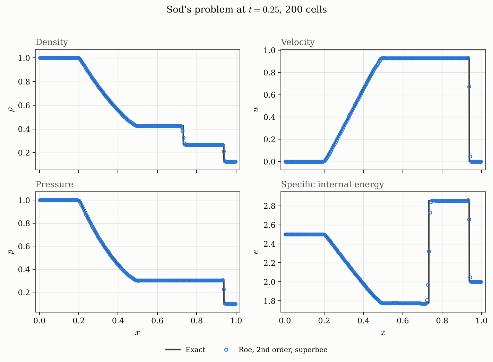
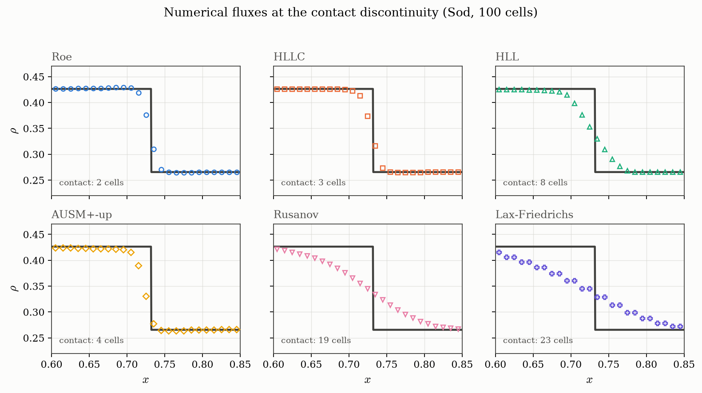
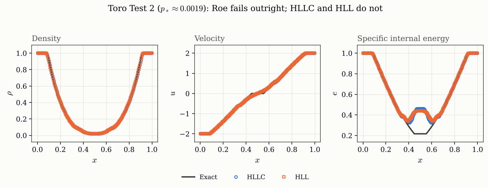
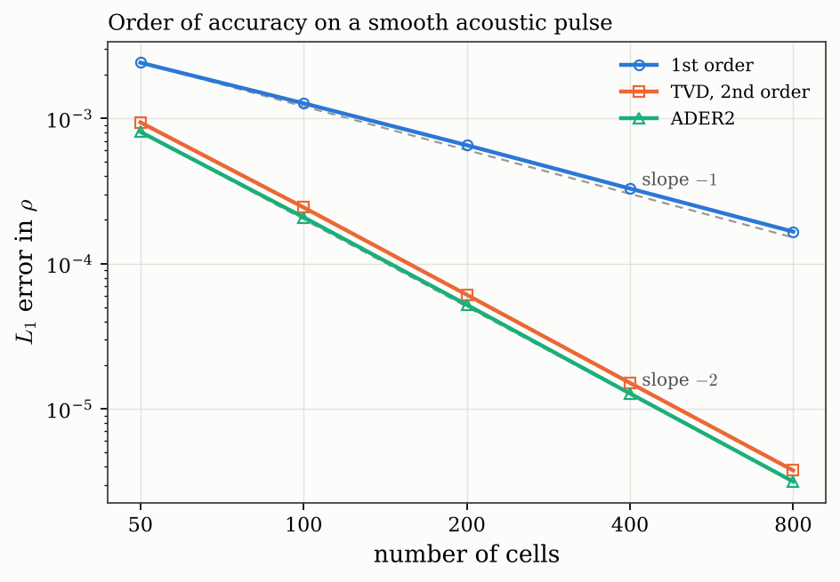
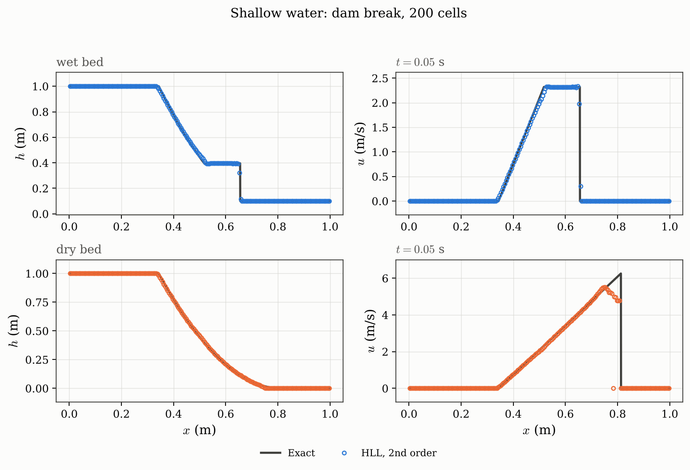
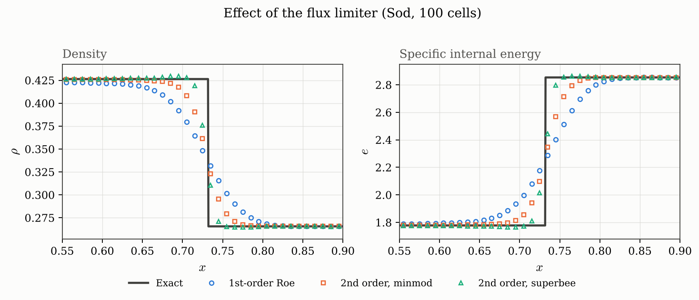
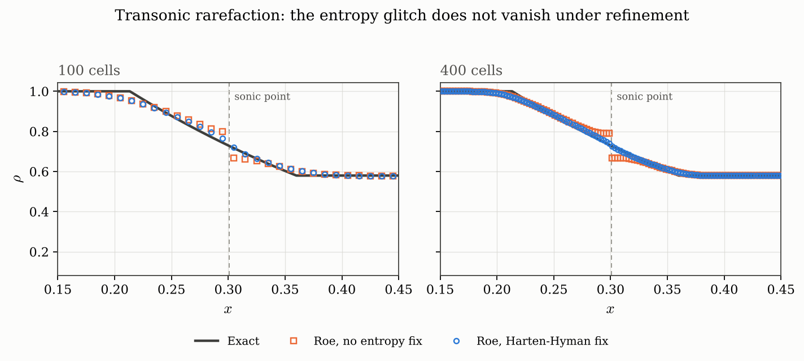

# Approximate Riemann Solver

Exact and approximate Riemann solvers for the one-dimensional Euler
equations, in Python, accelerated with [Numba](https://numba.pydata.org/).

*Managed by the Rodriguez Flow Research group at Brown University.*
*Developer: Mauro Rodriguez Jr. (mauro_rodriguez@brown.edu)*

This code is for educational and testing purposes. It follows
E. F. Toro, *Riemann Solvers and Numerical Methods for Fluid Dynamics*
(3rd ed., Springer 2009) throughout — every formula in the source carries the
chapter and equation number it comes from.



---

## What it does

- **Exact Riemann solver.** Newton–Raphson for the star-region pressure
  $p_{\ast}$ with Toro's adaptive initial guess, then closed-form self-similar
  sampling of the wave fan. Reproduces Toro's Table 4.1 to all published
  digits.
- **Six numerical fluxes**, interchangeable via one argument: **Roe** (with
  the **Harten–Hyman entropy fix**), **HLLC**, **HLL/HLLE**, **AUSM+-up**,
  **Rusanov** and **Lax–Friedrichs**.
- **Two second-order schemes**: a flux-limited **TVD** correction, and the
  one-step **ADER** scheme — no Runge–Kutta stages, second order in space and
  time within a single update.
- **The shallow-water equations** as a second system, with their own exact
  solver (wet *and* dry bed), fluxes and test problems.
- **Second-order TVD extension** with a choice of flux limiters — superbee,
  minmod, van Leer, van Albada — applied wave by wave.
- **Toro's five standard test problems** built in, plus a transonic case and a
  dimensional (SI) air shock tube.
- **Numba acceleration**, roughly 100× over pure Python, with a transparent
  fallback when Numba is not installed.
- **263 tests** checking the solvers against Toro's published values and
  against their own defining identities (the Roe U-property, the AUSM+ split
  identities, Sweby's TVD region, exact contact preservation, exact
  conservation).

---

## Getting started

### Install

Requires Python 3.9 or newer. From a clone of this repository:

```bash
git clone https://github.com/mrodrig6/approximate_riemann_solver.git
cd approximate_riemann_solver
pip install -e ".[all]"
```

`[all]` pulls in Numba (speed), matplotlib (figures) and pytest (tests). The
bare `pip install -e .` needs only NumPy — everything still runs, just slower
and without plots.

Check it works:

```bash
pytest
```

### Run a simple example

The quickest thing to run is Sod's shock tube, from the command line:

```bash
python -m src sod --plot sod.png
```

```
problem        : sod -- Sod's problem: left rarefaction, contact, right shock
reference      : Toro Test 1, Sec. 4.3.3 / Table 4.1
gamma, t_end   : 1.4, 0.25
left  (rho,u,p): [1. 0. 1.]
right (rho,u,p): [0.125 0.    0.1  ]
backend        : numba 0.68.0

exact solution : p* = 0.30313018, u* = 0.92745262 (4 Newton iterations)
wave pattern   : left rarefaction, contact, right shock

numerical run  : Roe, 2nd order, superbee, nx = 200, CFL = 0.9
                 122 steps to t = 0.25

error vs exact (on the numerical grid):
  rho  L1 = 1.4416e-03   relative L1 = 1.4416e-03
  u    L1 = 2.3999e-03   relative L1 = 2.5877e-03
  p    L1 = 9.3714e-04   relative L1 = 9.3714e-04
  e    L1 = 6.8311e-03   relative L1 = 2.3939e-03

figure written to sod.png
```

The same thing from Python:

```python
from src import solve_exact, solve, plot_comparison, save_figure

gamma = 1.4
w_left  = [1.000, 0.0, 1.0]   # [rho, u, p]
w_right = [0.125, 0.0, 0.1]
t_end   = 0.25

exact = solve_exact(gamma, w_left, w_right, t_end, n=2000)
roe   = solve(gamma, w_left, w_right, t_end, nx=200, limiter="superbee")
hllc  = solve(gamma, w_left, w_right, t_end, nx=200, flux="hllc")

print(f"p* = {exact.p_star:.6f}, u* = {exact.u_star:.6f}")

fig, _ = plot_comparison(exact=exact, numerical=[roe, hllc], title="Sod's shock tube")
save_figure(fig, "sod.png")
```

### More to try

```bash
python -m src --help                # all options, problems and fluxes
python -m src sod --flux hllc       # a different numerical flux
python -m src sod --scheme ader2    # the one-step ADER scheme
python -m src toro2 --flux hllc     # the near-vacuum case Roe cannot run
python -m src toro4 --nx 400        # two colliding strong shocks
python -m src sod --first-order     # drop the TVD correction, see the difference
python -m src sod --limiter minmod  # a more diffusive limiter
python -m src air_shock_tube --dimensional --plot air.png
```

Three worked examples, each runnable directly:

```bash
python examples/sod_shock_tube.py          # the basics
python examples/compare_fluxes.py          # all six fluxes side by side
python examples/shallow_water_dam_break.py # shallow water, wet and dry bed
python examples/compare_limiters.py        # first vs second order, four limiters
python examples/dimensional_shock_tube.py  # SI units
```

And two utility scripts:

```bash
python scripts/make_figures.py   # regenerate every figure in docs/
python scripts/benchmark.py      # time the solver; prefix NUMBA_DISABLE_JIT=1 to compare
```

---

## Documentation

Full write-up of the formulation, with the Toro chapter and equation numbers,
in **[`docs/`](docs/index.md)**:

| Page | Covers |
| --- | --- |
| [The Riemann problem for the Euler equations](docs/formulation.md) | Toro Ch. 3–4: governing equations, wave structure, $f(p_{\ast}) = 0$, sampling, vacuum |
| [Numerical flux functions](docs/flux-functions.md) | Toro Ch. 10 and Liou 2006: Roe, HLLC, HLL, AUSM+-up, Rusanov, Lax–Friedrichs; measured accuracy, cost and robustness |
| [Roe's solver in detail](docs/roe-solver.md) | Toro Ch. 11: linearisation, U-property, Roe averages, entropy fix, limitations |
| [The finite-volume scheme](docs/finite-volume-scheme.md) | Toro Ch. 6, 13–14: conservative update, CFL, boundaries, flux limiting, Sweby's region |
| [The ADER scheme](docs/ader.md) | Toro Ch. 19–20: the derivative Riemann problem, Cauchy–Kovalewski, measured order of accuracy |
| [The shallow-water equations](docs/shallow-water.md) | Toro's free-surface book: exact solver on wet and dry beds, fluxes, dam-break results |
| [Validation and results](docs/validation.md) | All figures and the numbers behind them |

---

## Built-in test problems

| Name | Description | Source |
| --- | --- | --- |
| `sod` | rarefaction, contact, shock — the standard first check | Toro Test 1 |
| `toro2` | "123 problem", near-vacuum star state — **Roe fails, by design** | Toro Test 2 |
| `toro3` | left half of the Woodward–Colella blast, pressure ratio $10^{5}$ | Toro Test 3 |
| `toro4` | right half of the blast — two colliding strong shocks | Toro Test 4 |
| `toro5` | slowly-moving contact, stresses contact resolution | Toro Test 5 |
| `sonic_rarefaction` | transonic fan — exercises the entropy fix | this repository |
| `air_shock_tube` | Mach ≈ 1.35 shock in air, SI units | dimensional case |

`toro2` is included *because* it fails. Roe's linearisation does not preserve
positivity of internal energy, so a near-vacuum star region drives the
internal energy negative in the first time step. This is a documented property
of the method (Einfeldt, Munz, Roe & Sjögreen 1991; Toro §11.4), it happens at
first order too, and the fix is a positivity-preserving flux — see the roadmap
below. The solver reports it with an explanation rather than a bare crash.

---

## Results at a glance

### The fluxes

Sod's problem, 100 cells, identical grid and limiter — only the first-order
flux differs. The contact is what separates them; all of them capture the
shock in one or two cells.



| Flux | Contact width | $L_1$ error in $\rho$ (200 cells) | µs / cell / step |
| --- | --- | --- | --- |
| Roe | 2 cells | $1.44 \times 10^{-3}$ | 0.48 |
| HLLC | 3 cells | $2.10 \times 10^{-3}$ | 0.31 |
| AUSM+-up | 4 cells | $6.59 \times 10^{-3}$ | 0.24 |
| HLL | 8 cells | $4.04 \times 10^{-3}$ | 0.35 |
| Rusanov | 19 cells | $1.28 \times 10^{-2}$ | 0.36 |
| Lax–Friedrichs | 24 cells | $2.22 \times 10^{-2}$ | 0.34 |

**HLLC is the best general-purpose choice**: contacts nearly as sharp as Roe,
cheaper, no entropy fix needed, and it runs every built-in problem — including
`toro2`, the near-vacuum case where Roe fails outright. **AUSM+-up** is the
cheapest of the six and resolves the contact in 4 cells; its coefficients are
adapted from the benchmarked implementation in EMS.



### Order of accuracy

Both second-order schemes reach their formal order on smooth data. (On a
discontinuity every scheme is first order in $L_1$, which is why the
[grid-convergence figure](docs/validation.md#4-grid-convergence) on Sod shows
slope $-1$ for all of them.)



### Shallow water



The dry case has a closed-form answer — Ritter's solution — and is the one a
wet-bed-only solver cannot run at all.

### The limiters

Sod's problem at 100 cells, measuring how many cells the contact is smeared
over. All three use the identical Roe flux and differ only in the limiter:

| Scheme | Contact width | $L_1$ error in $\rho$ |
| --- | --- | --- |
| First-order Roe | 14 cells | $1.51 \times 10^{-2}$ |
| Second order, minmod | 7 cells | $5.67 \times 10^{-3}$ |
| Second order, van Leer | 4 cells | $3.86 \times 10^{-3}$ |
| Second order, superbee | 2 cells | $2.62 \times 10^{-3}$ |



The entropy fix, on a transonic rarefaction. Without it, the error at the
sonic point does not shrink when the grid is refined — the signature of a
scheme converging to the wrong weak solution:



More, including grid convergence and all of Toro's tests, in
[`docs/validation.md`](docs/validation.md).

---

## Performance

Measured with `scripts/benchmark.py` on Sod's problem, on one machine — the
Numba row in particular is hardware-dependent, so re-run it rather than trust
it:

| Backend | Time per cell per step | 1600 cells, 975 steps |
| --- | --- | --- |
| Numba | 0.52 µs | 0.81 s |
| Pure Python | 28.0 µs | 43.7 s |

about a 54x speed-up for the compiled kernels.

Numba is optional. `src/core/jit.py` degrades `njit` to a no-op decorator when
Numba is absent, so the identical source runs either way; the test suite is
run under both (`NUMBA_DISABLE_JIT=1 pytest`) to keep the fallback honest.
Compiled kernels are cached to `__pycache__`, so the ~1 s compilation cost is
paid once per machine rather than once per process.

The kernels are compiled with most of LLVM's fast-math relaxations but
deliberately **not** `nnan` and `ninf`, which would licence the compiler to
assume no value is ever a NaN or an infinity. The positivity guards in the
solvers are written so that a NaN fails them, and granting those two would let
the compiler discard exactly those comparisons. Dropping them costs nothing
measurable; `src/core/jit.py` says more.

---

## Repository layout

```
src/
  core/                 machinery that knows about neither system
    jit.py                optional-Numba shim
    limiters.py           superbee, minmod, van Leer, van Albada
    plotting.py           four-panel comparison figures
  euler/                the 1-D Euler equations
    physics.py            equation of state, variable conversions, Euler flux
    exact.py              exact Riemann solver
    fluxes/
      registry.py           flux names and codes
      roe.py                Roe average, eigenstructure, Roe flux, entropy fix
      hll.py                Einfeldt wave speeds, HLL, HLLC
      ausm.py               split polynomials, AUSM+-up
      central.py            Rusanov, Lax-Friedrichs
      interface.py          flux dispatch and the second-order TVD term
    ader.py               the one-step ADER scheme
    solver.py             finite-volume driver, CFL, boundary conditions
    problems.py           test problems
  shallow_water/        the shallow-water equations
    physics.py            depth-averaged variables, celerity, the flux
    exact.py              exact solver, wet and dry bed
    fluxes/
      registry.py           flux names and codes
      roe.py                Roe average, eigenstructure, entropy fix, dry fallback
      hll.py                wave speeds with dry-bed handling, HLL
      central.py            Rusanov, Lax-Friedrichs
      interface.py          flux dispatch and the second-order TVD term
    solver.py             finite-volume driver, wet/dry handling
    problems.py           dam-break problems
  cli.py                python -m src
docs/                 formulation, flux functions, validation, figures
examples/             five runnable examples
scripts/              figure generation and benchmarking
tests/                263 pytest tests, mirroring src/ directory for directory
```

The two systems hold the same modules under the same names, each with the same
job, so a reader who knows one knows where to look in the other. The three
gaps — no shallow-water HLLC, AUSM+-up or ADER — are differences in the
equations, not in the code, and
[docs/architecture.md](docs/architecture.md) says why for each.

Every import points downwards: `core/` knows about neither system, and the two
systems never import each other. That page also has the import graph, what
each module owns, and where a new flux, limiter, scheme or system of equations
goes.

The original MATLAB implementation, which this package was ported from, is
archived on the
[`matlab-legacy`](https://github.com/mrodrig6/approximate_riemann_solver/tree/matlab-legacy)
branch.

---

## Roadmap

- **SLAU** (Shima & Kitamura 2011); `src/euler/fluxes/` is arranged so it slots
  in as another module beside `ausm.py`.
- **ADER beyond second order**: more Taylor terms in time and a
  higher-degree reconstruction, from the same template.
- **Shallow water with bed topography**, which needs a well-balanced
  treatment of the source term; the flat-bed solver here is the starting
  point, and still water is already an exact fixed point.
- MUSCL-Hancock reconstruction (Toro Ch. 14) as an alternative route to second
  order.
- Extension to two dimensions by dimensional splitting (Toro Ch. 16).
- Stiffened-gas and Mie–Grüneisen equations of state.


---

## Citation

If this code is useful in your work, please cite Toro's book for the methods
and this repository for the implementation:

```bibtex
@book{toro2009,
  author    = {Toro, Eleuterio F.},
  title     = {Riemann Solvers and Numerical Methods for Fluid Dynamics:
               A Practical Introduction},
  edition   = {3rd},
  publisher = {Springer},
  year      = {2009},
  doi       = {10.1007/b79761}
}
```

---

## License

MIT — see [LICENSE](LICENSE).
