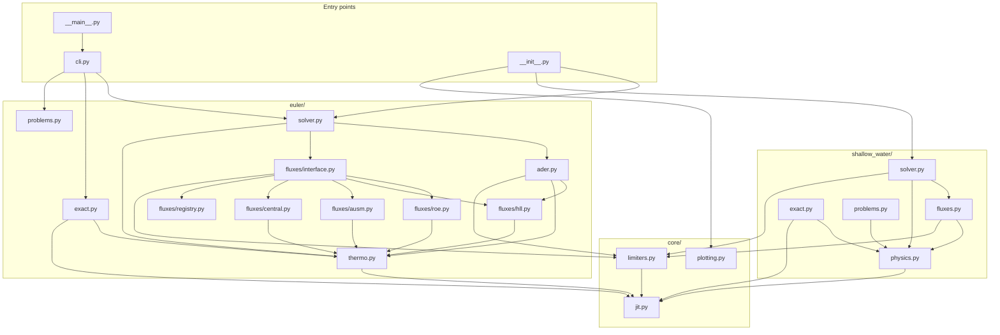

# Package architecture

How the modules of `src/` fit together: what each one owns, what it is allowed
to import, and where a new flux, scheme or system of equations goes.

---

## 1. Three layers

The package is a strict hierarchy. Every import points *downwards*, so the
import graph is acyclic and any module can be read without first reading the
ones above it.

| Layer | Contents | Knows about |
| --- | --- | --- |
| **Entry points** | `cli.py`, `__main__.py`, `__init__.py` | both systems |
| **Systems** | `euler/`, `shallow_water/` | their own equations only |
| **Core** | `core/` | neither system |

The dividing line is physics. `core/` holds a Numba shim, four TVD limiters
and the plotting helpers — a limiter is a function of the smoothness ratio
alone, and the plotting helpers take arrays and labels — so all three are
reused verbatim by both systems and belong to neither. Nothing in `core/`
imports from `euler/` or `shallow_water/`, and the two systems never import
each other.

That rule is what makes a third system of equations a self-contained addition
rather than an edit spread across the package.

---

## 2. Directory tree

```
src/
  __init__.py           the public API: re-exports from core/ and euler/
  __main__.py           python -m src
  cli.py                argument parsing, output, error tables

  core/                 system-independent machinery
    jit.py                optional-Numba shim: njit, HAVE_NUMBA
    limiters.py           superbee, minmod, van Leer, van Albada
    plotting.py           comparison figures (matplotlib imported lazily)

  euler/                the 1-D Euler equations
    thermo.py             equation of state, variable conversions, Euler flux
    exact.py              exact Riemann solver: Newton on p_star, then sampling
    fluxes/
      registry.py           flux names and integer codes
      roe.py                Roe average, eigenstructure, entropy fix
      hll.py                Einfeldt wave speeds, HLL, HLLC
      ausm.py               split Mach and pressure polynomials, AUSM+-up
      central.py            Rusanov, Lax-Friedrichs
      interface.py          flux dispatch and the second-order TVD term
    ader.py               the one-step ADER scheme
    solver.py             time loop, CFL, boundary conditions
    problems.py           Toro's tests and smooth initial fields

  shallow_water/        the shallow-water equations
    physics.py            variables, flux, Roe average, eigenstructure
    exact.py              exact solver, wet and dry bed
    fluxes.py             Roe, HLL, Rusanov, Lax-Friedrichs; TVD term
    solver.py             time loop
    problems.py           dam-break problems
```

`euler/fluxes/` is a package and `shallow_water/fluxes.py` is a single module.
The asymmetry is deliberate: there are six Euler fluxes and two of them run to
two hundred lines, while the whole shallow-water set is shorter than any one of
those files. There is also no shallow-water HLLC, because that system has no
contact wave for HLLC to restore.

---

## 3. Import graph

Every arrow is an actual `from ... import` in the source. Read it bottom-up:
`jit.py` depends on nothing, and `cli.py` depends on almost everything.



Only `__init__.py` and the examples reach across both systems. `cli.py`
exposes the Euler solvers alone; the shallow-water solvers are used from
Python, as in `examples/shallow_water_dam_break.py`.

---

## 4. What each module owns

Nothing is duplicated between the two systems except by necessity: each needs
its own equation of state, its own eigenstructure and its own wave-speed
estimates, because those *are* the equations.

| Module | Owns | Imports |
| --- | --- | --- |
| `core/jit.py` | `njit`, and the no-op fallback when Numba is absent | nothing |
| `core/limiters.py` | the four limiter functions, by integer code | `core/jit.py` |
| `core/plotting.py` | figure layout, mathtext labels, saving | nothing at import time |
| `euler/thermo.py` | ideal-gas EOS, `U` and `W` conversions, `F(U)` | `core/jit.py` |
| `euler/exact.py` | the pressure function, Newton iteration, sampling | `thermo` |
| `euler/fluxes/registry.py` | the flux name-to-code table | nothing |
| `euler/fluxes/roe.py` | Roe average, eigenstructure, Harten-Hyman fix | `thermo` |
| `euler/fluxes/hll.py` | Einfeldt wave speeds, HLL, HLLC | `thermo` |
| `euler/fluxes/ausm.py` | the split polynomials and AUSM+-up | `thermo` |
| `euler/fluxes/central.py` | Rusanov and Lax-Friedrichs | `thermo` |
| `euler/fluxes/interface.py` | dispatch by code, the TVD correction | the five above, `limiters` |
| `euler/ader.py` | the derivative Riemann problem and the ADER flux | `fluxes/hll.py`, `thermo`, `limiters` |
| `euler/solver.py` | the time loop, CFL, ghost cells, scheme choice | `ader`, `fluxes`, `thermo`, `limiters` |
| `euler/problems.py` | the problem catalogue | nothing |
| `shallow_water/physics.py` | depth-averaged variables, flux, eigenstructure | `core/jit.py` |
| `shallow_water/exact.py` | depth function, Stoker and Ritter solutions | `physics` |
| `shallow_water/fluxes.py` | the four fluxes, dispatch, TVD correction | `physics`, `limiters` |
| `shallow_water/solver.py` | the time loop, wet/dry handling | `fluxes`, `physics`, `limiters` |
| `shallow_water/problems.py` | dam-break catalogue, wet and dry | `physics` |

---

## 5. Where new code goes

The layout is arranged so that each kind of addition touches one place.

- **Another Euler flux** (SLAU, for instance): a new module in
  `euler/fluxes/`, a code in `registry.py`, a branch in `interface.py`.
  Nothing outside `euler/fluxes/` changes — the solver dispatches on the code.
- **Another limiter**: `core/limiters.py`, and both systems get it at once.
- **Another scheme** beside TVD and ADER: a module beside `euler/ader.py` and
  a branch in `solver.py`, which already selects on `scheme=`.
- **Another system of equations**: a new subpackage alongside `euler/` and
  `shallow_water/`, following the same five-module shape — `physics`,
  `exact`, `fluxes`, `solver`, `problems`. It imports `core/` and nothing
  else of the package.
- **Higher-order ADER**: `euler/ader.py` alone; the signature it presents to
  `solver.py` does not change with the order.

---

## 6. Tests and documentation

`tests/` mirrors the package rather than the directory tree: one file per
subject, each importing through the public API where it can.

| Test file | Covers |
| --- | --- |
| `test_thermo.py` | `euler/thermo.py` |
| `test_exact.py` | `euler/exact.py`, against analytic star states |
| `test_limiters.py` | `core/limiters.py`, including the Sweby region |
| `test_fluxes.py` | `euler/fluxes/`, all six, plus the split polynomials |
| `test_solver.py` | `euler/solver.py`, conservation and convergence |
| `test_ader.py` | `euler/ader.py`, and that it differs from TVD |
| `test_problems.py` | `euler/problems.py` |
| `test_cli.py` | `cli.py` |
| `test_shallow_water.py` | the whole `shallow_water/` subpackage |

The documentation pages follow the same division:
[the formulation and the exact solver](formulation.md) for `euler/thermo.py`
and `euler/exact.py`, [flux functions](flux-functions.md) for `euler/fluxes/`,
[the Roe solver](roe-solver.md) for `euler/fluxes/roe.py`, [the finite-volume
scheme](finite-volume-scheme.md) for `euler/solver.py`, [ADER](ader.md) for
`euler/ader.py`, and [shallow water](shallow-water.md) for that subpackage.

---

**Back to:** [Documentation index](index.md)
