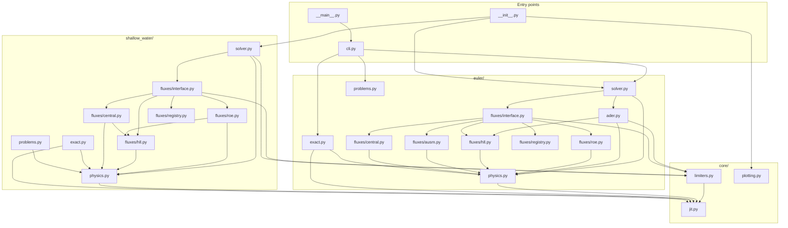

# Package architecture

How the modules of `src/` fit together: what each one owns, what it is allowed
to import, and where a new flux, scheme or system of equations goes.

---

## 1. Three layers

The package is a strict hierarchy. Every import points *downwards*, so the
import graph is acyclic and any module can be read without first reading the
ones above it.

| Layer | Contents | Knows about |
| --- | --- | --- |
| **Entry points** | `cli.py`, `__main__.py`, `__init__.py` | both systems |
| **Systems** | `euler/`, `shallow_water/` | their own equations only |
| **Core** | `core/` | neither system |

The dividing line is physics. `core/` holds a Numba shim, four TVD limiters
and the plotting helpers — a limiter is a function of the smoothness ratio
alone, and the plotting helpers take arrays and labels — so all three are
reused verbatim by both systems and belong to neither. Nothing in `core/`
imports from `euler/` or `shallow_water/`, and the two systems never import
each other.

That rule is what makes a third system of equations a self-contained addition
rather than an edit spread across the package.

---

## 2. The two systems are the same shape

`euler/` and `shallow_water/` hold the same modules under the same names, each
with the same job. A reader who knows one knows where to look in the other.

| Slot | Owns | Euler | Shallow water |
| --- | --- | --- | --- |
| `physics.py` | variables, closure, physical flux | ideal-gas EOS, `F(U)` | celerity, `F(U)` |
| `exact.py` | the exact Riemann solver | Newton on `p_star`, sampling | Newton on `h_star`, wet and dry |
| `fluxes/registry.py` | names and integer codes | 6 fluxes | 4 fluxes |
| `fluxes/roe.py` | Roe average, eigenstructure, Roe flux, entropy fix | Harten–Hyman | Harten, plus dry-bed fallback |
| `fluxes/hll.py` | wave-speed estimates and the HLL family | HLL, HLLC | HLL |
| `fluxes/central.py` | Rusanov, Lax-Friedrichs | ✓ | ✓ |
| `fluxes/ausm.py` | flux-vector splitting | AUSM+-up | — |
| `fluxes/interface.py` | dispatch, and the TVD correction | 3 fields | 2 fields |
| `ader.py` | the one-step ADER scheme | ✓ | — |
| `solver.py` | time loop, CFL, boundary conditions | ✓ | ✓, plus wet/dry |
| `problems.py` | the problem catalogue | Toro's tests | dam breaks |

Three cells in that table are empty, and all three are differences in the
*equations* rather than in the code:

- **No shallow-water HLLC.** HLLC exists to restore the contact wave that HLL
  averages away, and this system has no contact — both of its fields are
  genuinely non-linear. With no middle wave to put back, HLLC would compute
  the same numbers as HLL, so `flux="hllc"` is accepted as an alias rather
  than implemented twice. The same absence means HLL is *not* at the accuracy
  disadvantage here that it has for a gas: its two-wave model is the full wave
  structure, which is why it is the default.
- **No shallow-water AUSM+-up.** The AUSM family splits the flux by Mach
  number into a convective and a pressure part. A shallow-water flux has no
  pressure term in that sense — the `g h^2 / 2` term *is* the depth, not a
  separate thermodynamic variable. Shallow-water members of the family exist
  in the literature, but porting one is a research question rather than a
  transcription.
- **No shallow-water ADER.** This one is unfinished work rather than a
  statement about the equations. The construction carries over directly: the
  derivative Riemann problem needs the eigensystem at the Godunov state, which
  `fluxes/roe.py` already supplies for two fields.

One asymmetry runs the other way. `shallow_water/fluxes/central.py` and
`fluxes/roe.py` import from `fluxes/hll.py`, where their Euler twins do not:
Rusanov takes its dissipation coefficient from the same wave-speed estimate
HLL uses, because that is where the dry-bed handling lives, and the Roe flux
falls back to HLL at a dry interface. Both are the dry bed intruding, and both
are confined to this subpackage.

---

## 3. Directory tree

```
src/
  __init__.py           the public API: re-exports from core/ and euler/
  __main__.py           python -m src
  cli.py                argument parsing, output, error tables

  core/                 system-independent machinery
    jit.py                optional-Numba shim: njit, HAVE_NUMBA
    limiters.py           superbee, minmod, van Leer, van Albada
    plotting.py           comparison figures (matplotlib imported lazily)

  euler/                the 1-D Euler equations
    physics.py            equation of state, variable conversions, Euler flux
    exact.py              exact Riemann solver: Newton on p_star, then sampling
    fluxes/
      registry.py           flux names and integer codes
      roe.py                Roe average, eigenstructure, Harten-Hyman fix
      hll.py                Einfeldt wave speeds, HLL, HLLC
      ausm.py               split Mach and pressure polynomials, AUSM+-up
      central.py            Rusanov, Lax-Friedrichs
      interface.py          flux dispatch and the second-order TVD term
    ader.py               the one-step ADER scheme
    solver.py             time loop, CFL, boundary conditions
    problems.py           Toro's tests and smooth initial fields

  shallow_water/        the shallow-water equations
    physics.py            depth-averaged variables, celerity, the flux
    exact.py              exact solver, wet and dry bed
    fluxes/
      registry.py           flux names and integer codes
      roe.py                Roe average, eigenstructure, entropy fix, dry fallback
      hll.py                Einfeldt wave speeds, HLL
      central.py            Rusanov, Lax-Friedrichs
      interface.py          flux dispatch and the second-order TVD term
    solver.py             time loop, wet/dry handling
    problems.py           dam-break problems
```

---

## 4. Import graph

Every arrow is an actual `from ... import` in the source. Read it bottom-up:
`jit.py` depends on nothing, and `cli.py` depends on almost everything. The
two system subgraphs have the same shape, which is the point of §2.



Only `__init__.py` and the examples reach across both systems. `cli.py`
exposes the Euler solvers alone; the shallow-water solvers are used from
Python, as in `examples/shallow_water_dam_break.py`.

---

## 5. What each module owns

Nothing is shared between the two systems except through `core/`. Each needs
its own closure, its own eigenstructure and its own wave-speed estimates,
because those *are* the equations.

| Module | Owns | Imports |
| --- | --- | --- |
| `core/jit.py` | `njit`, the no-op fallback when Numba is absent, and the fast-math flag set | nothing |
| `core/limiters.py` | the four limiter functions, by integer code | `core/jit.py` |
| `core/plotting.py` | figure layout, mathtext labels, saving | nothing at import time |
| `euler/physics.py` | ideal-gas EOS, `U` and `W` conversions, `F(U)` | `core/jit.py` |
| `euler/exact.py` | the pressure function, Newton iteration, sampling | `physics` |
| `euler/fluxes/registry.py` | the flux name-to-code table, `ROBUST_FLUXES` | nothing |
| `euler/fluxes/roe.py` | Roe average, eigenstructure, Harten-Hyman fix | `physics` |
| `euler/fluxes/hll.py` | Einfeldt wave speeds, HLL, HLLC | `physics` |
| `euler/fluxes/ausm.py` | the split polynomials and AUSM+-up | `physics` |
| `euler/fluxes/central.py` | Rusanov and Lax-Friedrichs | `physics` |
| `euler/fluxes/interface.py` | dispatch by code, the TVD correction | the four above, `limiters` |
| `euler/ader.py` | the derivative Riemann problem and the ADER flux | `fluxes/hll.py`, `physics`, `limiters` |
| `euler/solver.py` | the time loop, CFL, ghost cells, scheme choice | `ader`, `fluxes`, `physics`, `limiters` |
| `euler/problems.py` | the problem catalogue | nothing |
| `shallow_water/physics.py` | depth-averaged variables, celerity, `F(U)` | `core/jit.py` |
| `shallow_water/exact.py` | depth function, Stoker and Ritter solutions | `physics` |
| `shallow_water/fluxes/registry.py` | the flux name-to-code table, `ROBUST_FLUXES` | nothing |
| `shallow_water/fluxes/roe.py` | Roe average, eigenstructure, entropy fix, dry fallback | `physics`, `fluxes/hll.py` |
| `shallow_water/fluxes/hll.py` | wave speeds with dry-bed handling, HLL | `physics` |
| `shallow_water/fluxes/central.py` | Rusanov and Lax-Friedrichs | `physics`, `fluxes/hll.py` |
| `shallow_water/fluxes/interface.py` | dispatch by code, the TVD correction | the three above, `limiters` |
| `shallow_water/solver.py` | the time loop, wet/dry handling | `fluxes`, `physics`, `limiters` |
| `shallow_water/problems.py` | dam-break catalogue, wet and dry | `physics` |

The two `registry.py` files keep their own code values rather than sharing a
table. There is no AUSM+-up on one side and `hllc` is an alias rather than a
flux of its own, so a shared table would have holes in it; `flux_code()` is
the only way in on either side.

---

## 6. Where new code goes

The layout is arranged so that each kind of addition touches one place.

- **Another flux** (SLAU, for instance): a new module in that system's
  `fluxes/`, a code in its `registry.py`, a branch in its `interface.py`.
  Nothing outside that directory changes — the solver dispatches on the code.
- **Another limiter**: `core/limiters.py`, and both systems get it at once.
- **Another scheme** beside TVD and ADER: a module beside `euler/ader.py` and
  a branch in `solver.py`, which already selects on `scheme=`.
- **Another system of equations**: a new subpackage alongside the two, with
  the same module names as §2 — `physics`, `exact`, `fluxes/`, `solver`,
  `problems`. It imports `core/` and nothing else of the package.
- **Higher-order ADER**: `euler/ader.py` alone; the signature it presents to
  `solver.py` does not change with the order.

---

## 7. Tests and documentation

`tests/` mirrors `src/`, directory for directory and file for file, so the
two systems' suites can be read side by side:

```
tests/
  test_cli.py
  core/            test_jit.py test_limiters.py
  euler/           test_physics.py test_exact.py test_fluxes.py
                   test_ader.py test_solver.py test_problems.py
  shallow_water/   test_physics.py test_exact.py test_fluxes.py
                   test_solver.py test_problems.py
```

Each pair of same-named files checks the same kind of property on the two
systems — `test_fluxes.py` the Roe U-property, flux consistency and upwinding
in supersonic or supercritical flow; `test_solver.py` fixed points,
conservation and agreement with the exact solution. The `__init__.py` files
are what let the two `test_exact.py` share a basename.

The documentation pages follow the same division:
[the formulation and the exact solver](formulation.md) for `euler/physics.py`
and `euler/exact.py`, [flux functions](flux-functions.md) for `euler/fluxes/`,
[the Roe solver](roe-solver.md) for `euler/fluxes/roe.py`, [the finite-volume
scheme](finite-volume-scheme.md) for `euler/solver.py`, [ADER](ader.md) for
`euler/ader.py`, and [shallow water](shallow-water.md) for that subpackage.

---

**Back to:** [Documentation index](index.md)
