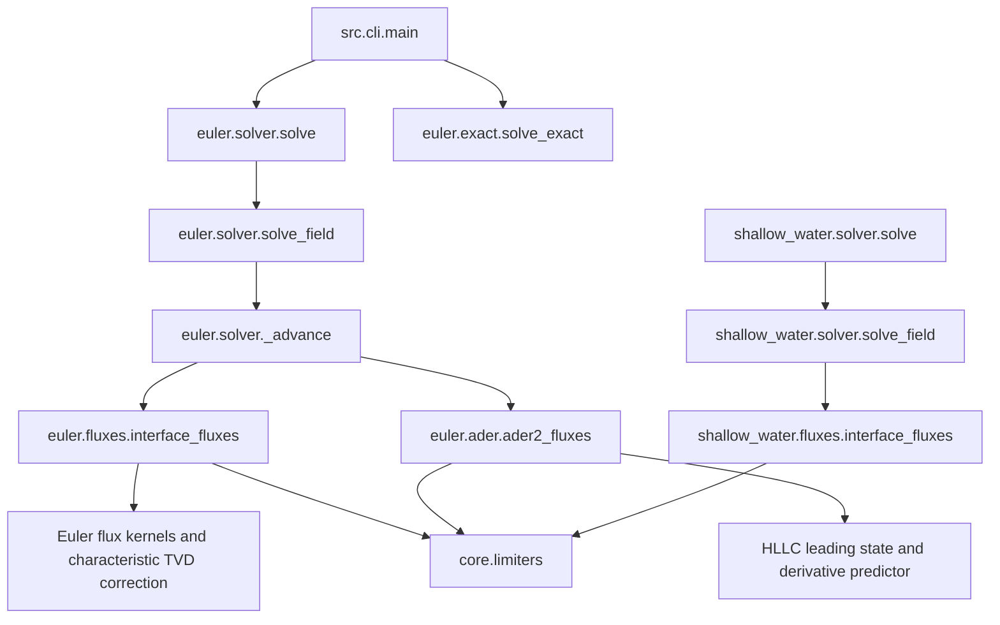

# Code map

The package separates shared helpers from the Euler and shallow-water systems. The
module table names the implementation; the diagram summarizes the solver call paths
rather than claiming to list every import.

## Three layers

The package is a strict hierarchy. Every import points *downwards*, so the import graph
is acyclic and any module can be read without first reading the ones above it.

| Layer            | Contents                               | Knows about              |
| ---------------- | -------------------------------------- | ------------------------ |
| **Entry points** | `cli.py`, `__main__.py`, `__init__.py` | both systems             |
| **Systems**      | `euler/`, `shallow_water/`             | their own equations only |
| **Core**         | `core/`                                | neither system           |

The dividing line is physics. `core/` holds a Numba shim, four TVD limiters and the
plotting helpers — a limiter is a function of the smoothness ratio alone, and the
plotting helpers take arrays and labels — so all three are reused verbatim by both
systems and belong to neither. Nothing in `core/` imports from `euler/` or
`shallow_water/`, and the two systems never import each other.

That rule is what makes a third system of equations a self-contained addition rather
than an edit spread across the package.

______________________________________________________________________

## The two systems are the same shape

`euler/` and `shallow_water/` hold the same modules under the same names, each with the
same job. A reader who knows one knows where to look in the other.

| Slot                  | Owns                                               | Euler                        | Shallow water                   |
| --------------------- | -------------------------------------------------- | ---------------------------- | ------------------------------- |
| `physics.py`          | variables, closure, physical flux                  | ideal-gas EOS, `F(U)`        | celerity, `F(U)`                |
| `exact.py`            | the exact Riemann solver                           | Newton on `p_star`, sampling | Newton on `h_star`, wet and dry |
| `fluxes/registry.py`  | names and integer codes                            | 6 fluxes                     | 4 fluxes                        |
| `fluxes/roe.py`       | Roe average, eigenstructure, Roe flux, entropy fix | Harten–Hyman                 | Harten, plus dry-bed fallback   |
| `fluxes/hll.py`       | wave-speed estimates and the HLL family            | HLL, HLLC                    | HLL                             |
| `fluxes/central.py`   | Rusanov, Lax-Friedrichs                            | ✓                            | ✓                               |
| `fluxes/ausm.py`      | flux-vector splitting                              | AUSM+-up                     | —                               |
| `fluxes/interface.py` | dispatch, and the TVD correction                   | 3 fields                     | 2 fields                        |
| `ader.py`             | the one-step ADER scheme                           | ✓                            | —                               |
| `solver.py`           | time loop, CFL, boundary conditions                | ✓                            | ✓, plus wet/dry                 |
| `problems.py`         | the problem catalogue                              | Toro's tests                 | dam breaks                      |

The missing entries have different causes:

- **No shallow-water HLLC.** HLLC exists to restore the contact wave that HLL averages
  away, and this system has no contact — both of its fields are genuinely non-linear.
  With no middle wave to put back, this implementation exposes HLLC as the same two-wave
  HLL operation, so `flux="hllc"` is accepted as an alias rather than implemented twice.
  The same absence means HLL is *not* at the accuracy disadvantage here that it has for
  a gas: it is a useful default here. Matching the number of waves does not make HLL an
  exact solver.
- **No shallow-water AUSM+-up.** The AUSM family splits the flux by Mach number into a
  convective and a pressure part. A shallow-water flux has no pressure term in that
  sense — the hydrostatic `g h^2 / 2` term depends on depth alone, not a separate
  thermodynamic variable. Shallow-water members of the family exist in the literature,
  but porting one is a research question rather than a transcription.
- **No shallow-water ADER.** This one is unfinished work rather than a statement about
  the equations. The construction carries over directly: the derivative Riemann problem
  needs the eigensystem at the Godunov state, which `fluxes/roe.py` already supplies for
  two fields.

One asymmetry runs the other way. `shallow_water/fluxes/central.py` and `fluxes/roe.py`
import from `fluxes/hll.py`, where their Euler twins do not: Rusanov takes its
dissipation coefficient from the same wave-speed estimate HLL uses, because that is
where the dry-bed handling lives, and the Roe flux falls back to HLL at a dry interface.
Both are the dry bed intruding, and both are confined to this subpackage.

______________________________________________________________________

## Solver call paths

## Functions and classes by module

| Module                                                                               | Contents                                                                      | Main functions or classes                                                                                                                                                               |
| ------------------------------------------------------------------------------------ | ----------------------------------------------------------------------------- | --------------------------------------------------------------------------------------------------------------------------------------------------------------------------------------- |
| [src/__init__.py](../../src/__init__.py)                                             | Exact and approximate Riemann solvers for the 1-D Euler equations.            | `public re-exports`                                                                                                                                                                     |
| [src/__main__.py](../../src/__main__.py)                                             | Allow `python -m src` to invoke the command-line interface.                   | `CLI entry point`                                                                                                                                                                       |
| [src/cli.py](../../src/cli.py)                                                       | Command-line interface: `python -m src`.                                      | `build_parser`, `main`                                                                                                                                                                  |
| [src/core/__init__.py](../../src/core/__init__.py)                                   | Machinery shared by both systems of equations.                                | `public re-exports`                                                                                                                                                                     |
| [src/core/jit.py](../../src/core/jit.py)                                             | Optional-Numba shim.                                                          | `CLI entry point`                                                                                                                                                                       |
| [src/core/limiters.py](../../src/core/limiters.py)                                   | Flux limiters for the second-order TVD extension of the finite-volume scheme. | `limiter_code`, `limiter_phi`                                                                                                                                                           |
| [src/core/plotting.py](../../src/core/plotting.py)                                   | Figure generation for the Riemann solvers.                                    | `use_paper_style`, `plot_comparison`, `plot_series`, `plot_shallow_water`, `save_figure`                                                                                                |
| [src/euler/__init__.py](../../src/euler/__init__.py)                                 | The 1-D Euler equations: equation of state, exact solver, fluxes, schemes.    | `public re-exports`                                                                                                                                                                     |
| [src/euler/ader.py](../../src/euler/ader.py)                                         | ADER: a one-step scheme built on the derivative Riemann problem.              | `ader2_fluxes`                                                                                                                                                                          |
| [src/euler/exact.py](../../src/euler/exact.py)                                       | Exact Riemann solver for the 1-D Euler equations with an ideal gas.           | `pressure_function`, `pressure_function_derivative`, `initial_pressure_guess`, `solve_star_pressure`, `ExactSolution`, `solve_exact`, `sample_exact`                                    |
| [src/euler/fluxes/__init__.py](../../src/euler/fluxes/__init__.py)                   | Numerical flux functions for the 1-D Euler equations.                         | `public re-exports`                                                                                                                                                                     |
| [src/euler/fluxes/ausm.py](../../src/euler/fluxes/ausm.py)                           | AUSM+-up: advection upstream splitting, all-speed variant.                    | `m4_plus`, `m4_minus`, `p5_plus`, `p5_minus`, `ausm_up_flux`                                                                                                                            |
| [src/euler/fluxes/central.py](../../src/euler/fluxes/central.py)                     | Central fluxes with scalar dissipation: Lax-Friedrichs and Rusanov.           | `lax_friedrichs_flux`, `rusanov_flux`                                                                                                                                                   |
| [src/euler/fluxes/hll.py](../../src/euler/fluxes/hll.py)                             | HLL-family fluxes: HLL (with Einfeldt wave speeds) and HLLC.                  | `einfeldt_wave_speeds`, `hll_flux`, `hllc_flux`                                                                                                                                         |
| [src/euler/fluxes/interface.py](../../src/euler/fluxes/interface.py)                 | Interface fluxes for the whole grid: flux dispatch plus the TVD correction.   | `interface_fluxes`                                                                                                                                                                      |
| [src/euler/fluxes/registry.py](../../src/euler/fluxes/registry.py)                   | Names and integer codes for the available numerical fluxes.                   | `flux_code`                                                                                                                                                                             |
| [src/euler/fluxes/roe.py](../../src/euler/fluxes/roe.py)                             | Roe's approximate Riemann solver, with the Harten-Hyman entropy fix.          | `roe_average`, `interface_eigensystem`, `roe_flux`                                                                                                                                      |
| [src/euler/physics.py](../../src/euler/physics.py)                                   | Ideal-gas thermodynamics and conversions between primitive and conservative   | `check_gamma`, `pressure`, `sound_speed`, `enthalpy`, `euler_flux`, `primitive_to_conservative_1`, `primitive_to_conservative`, `conservative_to_primitive`, `specific_internal_energy` |
| [src/euler/problems.py](../../src/euler/problems.py)                                 | Catalogue of standard Riemann-problem test cases.                             | `RiemannProblem`, `get_problem`, `list_problems`, `advected_pulse`, `acoustic_pulse`, `cell_centres`                                                                                    |
| [src/euler/solver.py](../../src/euler/solver.py)                                     | Explicit finite-volume driver: conservative update, CFL time step and         | `EulerResult`, `solve`, `solve_field`                                                                                                                                                   |
| [src/shallow_water/__init__.py](../../src/shallow_water/__init__.py)                 | Shallow-water equations: exact and approximate Riemann solvers.               | `public re-exports`                                                                                                                                                                     |
| [src/shallow_water/exact.py](../../src/shallow_water/exact.py)                       | Exact Riemann solver for the shallow-water equations.                         | `depth_function`, `is_dry_bed`, `solve_star_depth`, `ShallowWaterSolution`, `solve_exact`                                                                                               |
| [src/shallow_water/fluxes/__init__.py](../../src/shallow_water/fluxes/__init__.py)   | Numerical flux functions for the shallow-water equations.                     | `public re-exports`                                                                                                                                                                     |
| [src/shallow_water/fluxes/central.py](../../src/shallow_water/fluxes/central.py)     | Central fluxes with scalar dissipation: Lax-Friedrichs and Rusanov.           | `lax_friedrichs_flux`, `rusanov_flux`                                                                                                                                                   |
| [src/shallow_water/fluxes/hll.py](../../src/shallow_water/fluxes/hll.py)             | The HLL flux, and the wave-speed estimates every flux here is built on.       | `einfeldt_wave_speeds`, `hll_flux`                                                                                                                                                      |
| [src/shallow_water/fluxes/interface.py](../../src/shallow_water/fluxes/interface.py) | Flux dispatch at every interface, and the second-order TVD correction.        | `interface_fluxes`                                                                                                                                                                      |
| [src/shallow_water/fluxes/registry.py](../../src/shallow_water/fluxes/registry.py)   | Names and integer codes for the available numerical fluxes.                   | `flux_code`                                                                                                                                                                             |
| [src/shallow_water/fluxes/roe.py](../../src/shallow_water/fluxes/roe.py)             | Roe's approximate Riemann solver, with a Harten entropy fix.                  | `roe_average`, `interface_eigensystem`, `roe_flux`, `interface_eigensystem_wet`                                                                                                         |
| [src/shallow_water/physics.py](../../src/shallow_water/physics.py)                   | Variables, closure and physical flux for the shallow-water equations.         | `check_gravity`, `celerity`, `swe_flux`, `primitive_to_conservative`, `conservative_to_primitive`                                                                                       |
| [src/shallow_water/problems.py](../../src/shallow_water/problems.py)                 | Standard shallow-water test problems.                                         | `ShallowWaterProblem`, `get_problem`, `list_problems`                                                                                                                                   |
| [src/shallow_water/solver.py](../../src/shallow_water/solver.py)                     | Explicit finite-volume driver for the shallow-water equations.                | `ShallowWaterResult`, `solve`, `solve_field`                                                                                                                                            |
