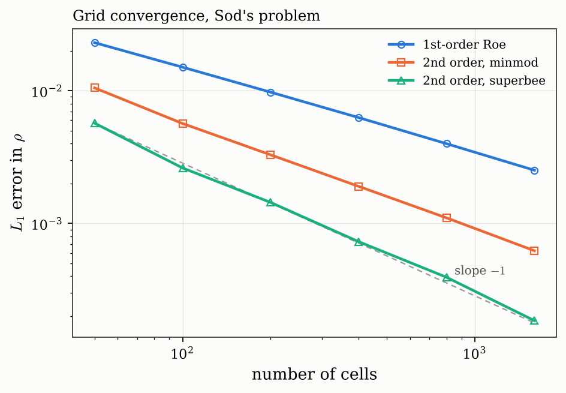
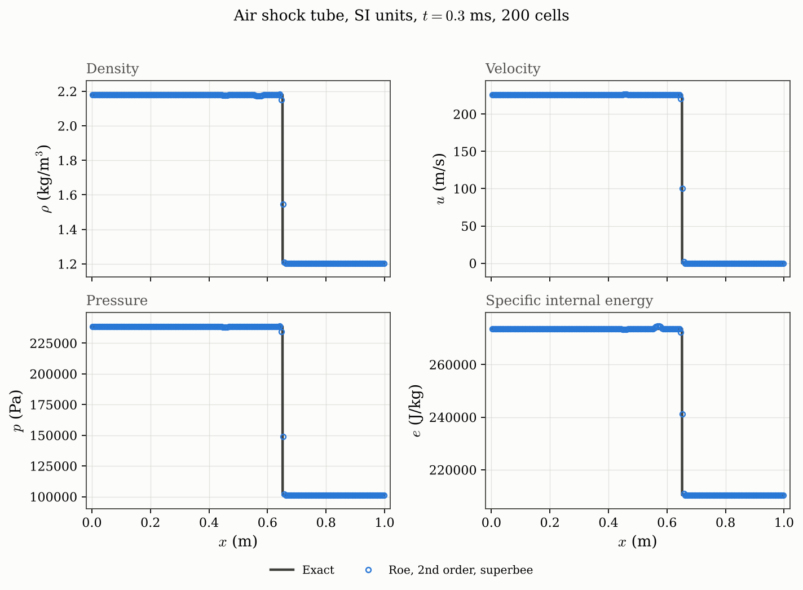

# Validation and results

Every figure on this page is produced by `scripts/make_figures.py`, which runs
the solvers in this repository and writes into `docs/figures/`. The solvers
are deterministic, so the figures are exactly reproducible:

```bash
python scripts/make_figures.py
```

The reference in every comparison is the **exact** Riemann solver of
[formulation.md](formulation.md), sampled at 2000 points. Its star-region
values are checked against Toro's published Table 4.1 in
`tests/test_exact.py`, so the baseline itself is verified against the textbook
rather than against a previous run of this code.

---

## 1. Sod's shock tube

The standard first check (Toro Test 1). Left state $(1, 0, 1)$, right state
$(0.125, 0, 0.1)$, $\gamma = 1.4$, output at $t = 0.25$. The solution is a
left rarefaction, a contact and a right shock.


Exact: $p_{\ast} = 0.30313018$, $u_{\ast} = 0.92745262$, reached in 4 Newton
iterations. Toro's Table 4.1 gives $0.30313$ and $0.92745$.

Reading the four panels together is the point of plotting all four. The
contact at $x \approx 0.73$ is plainly visible in $\rho$ and in $e$, and
entirely absent from $u$ and $p$ — exactly as the theory requires, since
velocity and pressure are continuous across a linearly degenerate wave. The
shock at $x \approx 0.93$ appears in all four.

---

## 2. Order of accuracy and the limiters

All three runs below use the identical Roe flux. They differ only in whether
the second-order correction of
[finite-volume-scheme.md](finite-volume-scheme.md) is applied, and with
which limiter.


Measured on Sod's problem at 100 cells, counting cells whose density lies
strictly between the two plateau values across the contact:

| Scheme | Contact width (cells) | $L_1$ error in $\rho$ |
| --- | --- | --- |
| First-order Roe | 14 | $1.51 \times 10^{-2}$ |
| Second order, minmod | 7 | $5.67 \times 10^{-3}$ |
| Second order, van Leer | 4 | $3.86 \times 10^{-3}$ |
| Second order, superbee | 2 | $2.62 \times 10^{-3}$ |

The ordering is exactly what the limiter functions predict: superbee sits on
the upper (compressive) edge of Sweby's TVD region and minmod on the lower
(diffusive) edge, with van Leer between them. None of the runs oscillates,
which is the TVD property doing its job.

The shock, by contrast, is captured in one or two cells by *every* variant.
That is Roe's U-property: an isolated shock is an exact solution of the
linearised problem, so there is nothing for the scheme to smear.

---

## 3. The entropy fix

The transonic case of [roe-solver.md](roe-solver.md#4-the-entropy-fix). The
initial data are chosen so the left rarefaction fan straddles the diaphragm
and contains a sonic point, where $u - a$ changes sign inside the wave. Both
runs are first order, so that the effect is not masked by the limiter.


Without the fix (orange squares) a step of fixed height sits at the sonic
point: the unphysical "rarefaction shock". The decisive observation is the
comparison *between* the two panels. Quadrupling the resolution from 100 to
400 cells leaves the unfixed error essentially unchanged, while the fixed
solution converges normally:

| | 100 cells | 400 cells |
| --- | --- | --- |
| Max error in $\rho$ across the fan, **with** Harten–Hyman | $4.21 \times 10^{-2}$ | $2.72 \times 10^{-2}$ |
| Max error in $\rho$ across the fan, **without** | $5.40 \times 10^{-2}$ | $5.86 \times 10^{-2}$ |

An ordinary discretisation error would shrink under refinement. One that does
not is a sign that the scheme is converging to the wrong weak solution — which
is precisely what an entropy-violating scheme does. `tests/test_roe.py`
asserts this non-convergence, so the fix cannot be silently disabled.

---

## 4. Grid convergence

$L_1$ error in density on Sod's problem, from 50 to 1600 cells.



All three curves have slope $\approx -1$, **not** $-2$, and that is the
correct result rather than a defect. For the formal order, measured on
smooth data where it is visible, see
[ader.md](ader.md#3-order-of-accuracy). The exact solution contains a shock and a
contact; near a discontinuity any scheme makes an $\mathcal{O}(1)$ error over
an $\mathcal{O}(\Delta x)$-wide region, which contributes
$\mathcal{O}(\Delta x)$ to the $L_1$ norm however accurate the scheme is
elsewhere. A genuine second-order *rate* is only observable on a smooth test
problem.

What the second-order correction delivers is a smaller constant: the superbee
curve sits about a factor of 6 below the first-order one, so it reaches the
same accuracy on a grid roughly six times coarser.

---

## 5. Toro's test suite

The four tests of Toro §4.3.3 that the Roe scheme can run, at 200 cells with
superbee. (Test 2 is the exception; see §6.)


Relative $L_1$ errors against the exact solution on the same grid:

| Problem | Steps | $\rho$ | $u$ | $p$ |
| --- | --- | --- | --- | --- |
| `sod` (Test 1) | 122 | $1.4 \times 10^{-3}$ | $2.6 \times 10^{-3}$ | $9.4 \times 10^{-4}$ |
| `toro3` (Test 3, blast left half) | 144 | $7.8 \times 10^{-3}$ | $1.2 \times 10^{-2}$ | $4.5 \times 10^{-3}$ |
| `toro4` (Test 4, colliding shocks) | 234 | $5.2 \times 10^{-3}$ | $3.5 \times 10^{-3}$ | $3.8 \times 10^{-3}$ |
| `toro5` (Test 5, slow contact) | 146 | $5.8 \times 10^{-3}$ | $7.4 \times 10^{-3}$ | $4.7 \times 10^{-3}$ |
| `sonic_rarefaction` | 122 | $2.1 \times 10^{-3}$ | $3.3 \times 10^{-3}$ | $1.5 \times 10^{-3}$ |
| `air_shock_tube` | 42 | $9.9 \times 10^{-4}$ | $2.5 \times 10^{-3}$ | $1.2 \times 10^{-3}$ |

Tests 3 and 4 involve pressure ratios of $10^{5}$ and two colliding strong
shocks respectively, and are resolved to under 1% with no special treatment.

---

## 6. A documented failure: Toro's Test 2 (for the Roe flux)

Test 2 — the "123 problem", $\rho = 1$, $u = \mp 2$, $p = 0.4$ — is **not**
shown above because Roe's solver cannot run it:

```console
$ python -m src toro2
exact solution : p* = 0.0018938734, u* = 0 (1 Newton iterations)
wave pattern   : left rarefaction, contact, right rarefaction

numerical run FAILED:
flux='roe' produced a non-physical state (negative pressure or density) at step 1 ...
```

**This is now fixable.** A positivity-preserving flux runs it:

```console
$ python -m src toro2 --flux hllc
numerical run  : HLLC, 2nd order, superbee, nx = 200, CFL = 0.9
  rho  L1 = 4.5816e-03   relative L1 = 4.5816e-03
```


See [flux-functions.md](flux-functions.md#6-robustness) for the full
flux-versus-problem matrix.

The exact solver handles it fine — in a single Newton iteration, because
Toro's two-rarefaction initial guess is exact when both waves are
rarefactions. It is the *approximate* solver that fails, and it fails at first
order, at every CFL number, with every limiter. That uniformity is how one
identifies the cause as the flux itself rather than the reconstruction or the
time-stepping: the Roe linearisation does not preserve positivity of internal
energy near vacuum.

See [roe-solver.md](roe-solver.md#5-known-limitation-roes-solver-is-not-positivity-preserving)
for the full explanation and the reference.

---

## 6a. The numerical fluxes compared

Six fluxes, the same problem, the same limiter, the same grid — only the
first-order flux differs. The contact is where they separate; every one of
them captures the shock in one or two cells.


| Flux | Contact width (100 cells) | $L_1$ error in $\rho$ (200 cells) |
| --- | --- | --- |
| Roe | 2 cells | $1.44 \times 10^{-3}$ |
| HLLC | 3 cells | $2.10 \times 10^{-3}$ |
| AUSM+-up | 4 cells | $6.59 \times 10^{-3}$ |
| HLL | 8 cells | $4.04 \times 10^{-3}$ |
| Rusanov | 19 cells | $1.28 \times 10^{-2}$ |
| Lax-Friedrichs | 24 cells | $2.22 \times 10^{-2}$ |

Full discussion, including the AUSM+-up coefficients adapted from EMS and why
Lax-Friedrichs ignores the TVD correction entirely, is in
[flux-functions.md](flux-functions.md).

---

## 7. A dimensional case

All the cases above are non-dimensional. `air_shock_tube` is a Mach
$\approx 1.35$ shock running into air at standard conditions, in SI units,
output at $t = 0.3$ ms.



The left state was constructed as the exact post-shock state of a right-running
shock, so the left wave is a null wave and the solution is essentially a single
shock — captured here in one or two cells.

This case is worth keeping precisely because of its units. A fixed initial
pressure guess, or an *absolute* Newton tolerance, would be meaningless at
$p \approx 10^{5}$ Pa. Toro's adaptive initial guess and a relative
convergence criterion are both scale-free, so the same code runs this case
and Sod's without any tuning — here in 3 Newton iterations.

---

## 8. Test suite

```bash
pytest
```

263 tests covering, among others:

- star-region values against Toro's Table 4.1 for all five of his test
  problems;
- the pressure-function derivative against a finite difference, which pins
  the easily-mistaken rarefaction exponent;
- Newton's independence from the initial guess, across 10 decades;
- Roe's **U-property**, $\mathbf{F}_R - \mathbf{F}_L = \sum_k \tilde{\alpha}_k \tilde{\lambda}_k \tilde{\mathbf{K}}_k$, to $10^{-10}$;
- reconstruction of the jump, $\Delta\mathbf{U} = \sum_k \tilde{\alpha}_k \tilde{\mathbf{K}}_k$;
- every limiter inside Sweby's TVD region, and $\phi(1) = 1$;
- exact conservation of mass and energy, and momentum changing at exactly the
  rate set by the boundary pressures;
- a uniform state being a fixed point of the scheme;
- the solution landing exactly on the requested output time;
- the entropy glitch failing to converge when the fix is disabled;
- Toro Test 2 failing for Roe with the documented message, and succeeding
  for HLLC and HLL;
- consistency, `F(U, U) = F(U)`, for every flux over a spread of states;
- the two exact AUSM+ split-function identities, and the moving-contact
  invariant that caught a mis-scaled AUSM+-up coefficient;
- exact contact preservation (stationary and moving) for Roe, HLLC and
  AUSM+-up, and its absence for HLL, Rusanov and Lax-Friedrichs;
- the measured accuracy ordering Roe < HLLC < HLL < Rusanov < Lax-Friedrichs;
- Lax-Friedrichs odd-even decoupling nullifying the limiter;
- second-order convergence of the TVD and ADER schemes on smooth data, and
  their agreement to machine precision on a pure contact;
- for the shallow-water system: the Roe U-property, Ritter's analytic
  dry-dam-break solution, dry-bed generation, still water as an exact fixed
  point, and every flux on every dam-break problem.

The suite passes identically with and without Numba
(`NUMBA_DISABLE_JIT=1 pytest`), which verifies the pure-Python fallback path.

---

**Back to:** [Documentation index](index.md)
