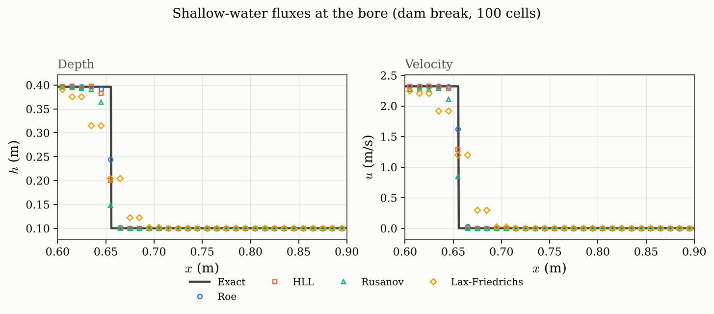

# Shallow-water validation

The dry dam break has the analytic Ritter reference. Wet-bed numerical errors use this
package's exact shallow-water solver; `tests/shallow_water/` checks both kinds of
evidence.

## Results

Relative $L_1$ error in depth at 200 cells, second order with superbee:

| Problem            | Pattern                  | Roe                | HLL                | Rusanov            | LF                 |
| ------------------ | ------------------------ | ------------------ | ------------------ | ------------------ | ------------------ |
| `dam_break`        | rarefaction, bore        | $1.0\times10^{-3}$ | $2.3\times10^{-3}$ | $6.8\times10^{-3}$ | $1.1\times10^{-2}$ |
| `dam_break_dry`    | rarefaction to dry       | $1.9\times10^{-3}$ | $2.7\times10^{-3}$ | $9.6\times10^{-3}$ | $1.8\times10^{-2}$ |
| `two_bores`        | bore, bore               | $2.0\times10^{-3}$ | $2.0\times10^{-3}$ | $4.6\times10^{-3}$ | $9.9\times10^{-3}$ |
| `two_rarefactions` | rarefaction, rarefaction | $3.2\times10^{-3}$ | $3.0\times10^{-3}$ | $4.0\times10^{-3}$ | $1.6\times10^{-2}$ |
| `dry_generation`   | dry region opens         | $7.5\times10^{-3}$ | $8.8\times10^{-3}$ | $4.3\times10^{-3}$ | $5.5\times10^{-2}$ |
| `subcritical_step` | weak step                | $5.1\times10^{-4}$ | $6.1\times10^{-4}$ | $1.6\times10^{-3}$ | $3.2\times10^{-3}$ |

Note how much closer Roe and HLL are here than in the
[Euler comparison](flux-comparison.md), where HLL is about three times worse. That is
the missing contact: for a gas HLL pays for averaging the contact away, and here there
is nothing to average away.

Order of accuracy on a smooth depth pulse, measured as in
[ADER2 method](convergence.md): 1.0 at first order, 2.0 with the TVD correction.

## Analytic dry-bed check

For initial depth 1 m at rest and gravity 9.81 m/s², the worked example prints depth
0.444444 m at the dam, velocity 2.088061 m/s, and front speed 6.264184 m/s. These are
the rounded Ritter values `4/9`, `2*sqrt(g)/3`, and `2*sqrt(g)`.
`tests/shallow_water/test_exact.py` checks depth and velocity to relative 1e-3 on its
sample grid and front position to a two-cell absolute tolerance.
`test_dry_dam_break_matches_ritter` checks the numerical dam-site depth to relative 5%
and mean depth error below 0.01.

Recompute the profile table with `python scripts/record_validation.py`. It uses 200
cells, superbee, and each problem's catalogue CFL; relative depth error divides mean
absolute error by maximum exact depth.

## Figure source

Rebuild these images with `python scripts/make_figures.py` from the repository root.
Source lives beside the images in [make_figures.py](../figures/make_figures.py):
`figure_shallow_water`, `figure_shallow_water_fluxes`.
