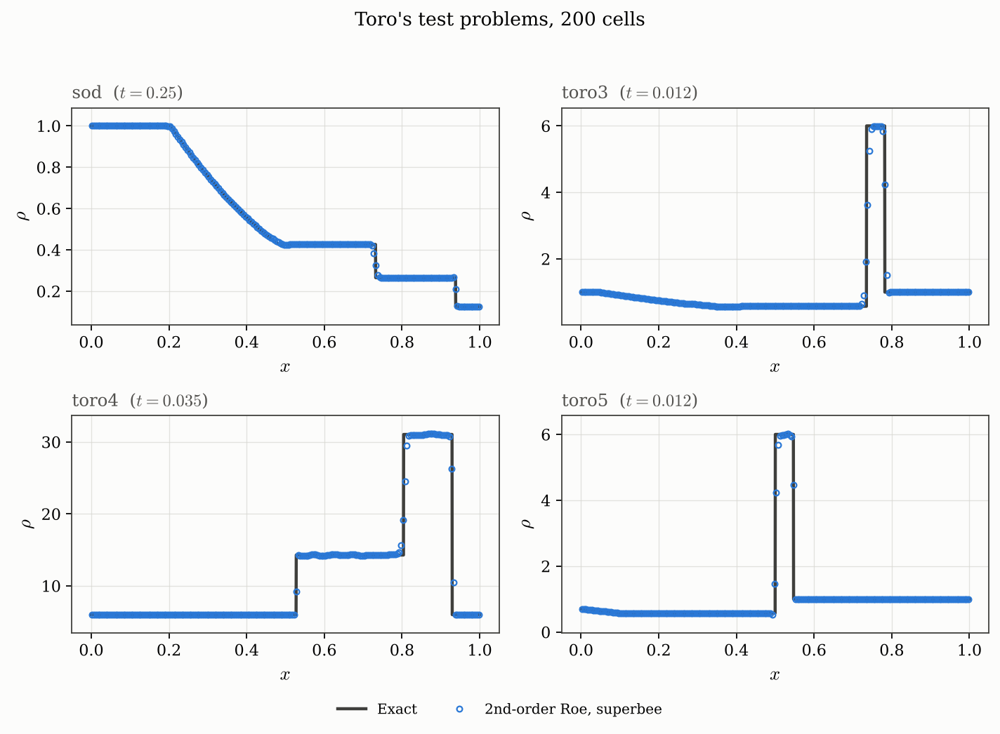

# Toro reference cases

The exact solver is compared with the published star-state values in Toro Table 4.1.
Finite-volume errors below instead compare numerical profiles with this package's exact
solver; these are different kinds of evidence.

## Published star states

The following values were recomputed with `python scripts/record_validation.py`. The
published columns reproduce the reference values used by `tests/euler/test_exact.py`;
they are rounded textbook data, not infinite-precision answers.

| Problem | Published p-star | Computed p-star | Absolute difference | Published u-star | Computed u-star | Absolute difference |
| ------- | ---------------- | --------------- | ------------------- | ---------------- | --------------- | ------------------- |
| `sod`   | 0.30313          | 0.3031301781    | 1.781e-07           | 0.92745          | 0.92745262      | 2.620e-06           |
| `toro2` | 0.00189          | 0.00189387342   | 3.873e-06           | 0                | 0               | 0.000e+00           |
| `toro3` | 460.894          | 460.8937875     | 2.125e-04           | 19.5975          | 19.59745139     | 4.861e-05           |
| `toro4` | 1691.64          | 1691.646955     | 6.955e-03           | 8.68975          | 8.689774412     | 2.441e-05           |
| `toro5` | 460.894          | 460.8937875     | 2.125e-04           | 0                | 1.388723053e-06 | 1.389e-06           |

The test accepts pressure with `rel=1e-4, abs=1e-5` and velocity with
`rel=1e-4, abs=1e-4`. Agreement is within those published-precision tolerances; it is
not equality of every printed digit. For example, Test 4 pressure differs by about
0.007, and Test 5 velocity is about 1.4e-6 because its input shift is rounded.

## Toro's test suite

The four tests of Toro §4.3.3 that the Roe scheme can run, at 200 cells with superbee.
(Test 2 is the exception; see the
[failure discussion](#a-documented-failure-toros-test-2-for-the-roe-flux).)

Relative $L_1$ errors against the exact solution on the same grid:

| Problem                            | Steps | $\rho$               | $u$                  | $p$                  |
| ---------------------------------- | ----- | -------------------- | -------------------- | -------------------- |
| `sod` (Test 1)                     | 122   | $1.4 \times 10^{-3}$ | $2.6 \times 10^{-3}$ | $9.4 \times 10^{-4}$ |
| `toro3` (Test 3, blast left half)  | 144   | $7.8 \times 10^{-3}$ | $1.2 \times 10^{-2}$ | $4.5 \times 10^{-3}$ |
| `toro4` (Test 4, colliding shocks) | 234   | $5.2 \times 10^{-3}$ | $3.5 \times 10^{-3}$ | $3.8 \times 10^{-3}$ |
| `toro5` (Test 5, slow contact)     | 146   | $5.8 \times 10^{-3}$ | $7.4 \times 10^{-3}$ | $4.7 \times 10^{-3}$ |
| `sonic_rarefaction`                | 122   | $2.1 \times 10^{-3}$ | $3.3 \times 10^{-3}$ | $1.5 \times 10^{-3}$ |
| `air_shock_tube`                   | 42    | $9.9 \times 10^{-4}$ | $2.5 \times 10^{-3}$ | $1.2 \times 10^{-3}$ |

Tests 3 and 4 involve pressure ratios of $10^{5}$ and two colliding strong shocks
respectively, and give small profile errors under these settings. The velocity error on
`toro3` is about 1.2%, so a blanket claim that every field is below 1% would be
incorrect.

______________________________________________________________________

## A documented failure: Toro's Test 2 (for the Roe flux)

Test 2 — the "123 problem", $\rho = 1$, $u = \mp 2$, $p = 0.4$ — is **not** shown above
because Roe's solver cannot run it. The
[troubleshooting page](../running/troubleshooting.md) shows the observed error.

The default HLLC/TVD configuration runs it: `python -m src toro2 --flux hllc`.

See [Euler flux methods](../reference/compatibility.md) for the full flux-versus-problem
matrix.

The exact solver handles it fine — in a single Newton iteration, because Toro's
two-rarefaction initial guess is exact when both waves are rarefactions. It is the
*approximate* solver that fails, and it also fails at first order under the tested
settings. Changing the limiter does not repair the underlying near-vacuum defect. That
uniformity is how one identifies the cause as the flux itself rather than the
reconstruction or the time-stepping: the Roe linearisation does not preserve positivity
of internal energy near vacuum.

See [Roe theory](../running/troubleshooting.md) for the full explanation and the
reference.

## Figure source

Rebuild these images with `python scripts/make_figures.py` from the repository root.
Source lives beside the images in [make_figures.py](../figures/make_figures.py):
`figure_toro_suite`, `figure_toro2_positivity`.
